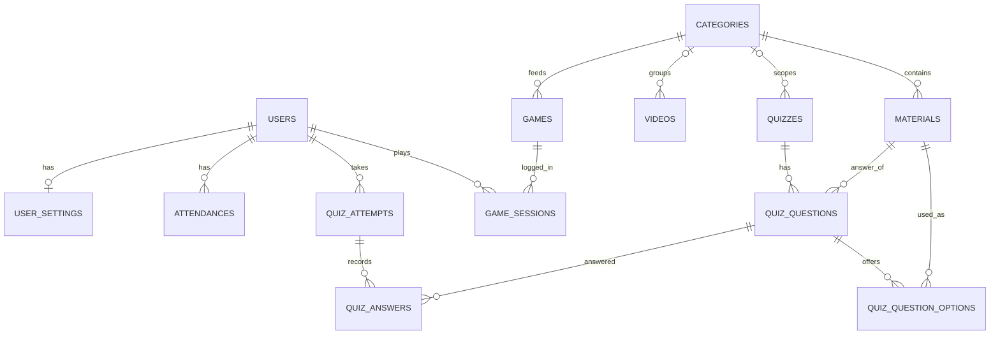

# RANCANGAN BASIS DATA & KAMUS DATA (03-erd-database.md)
**Proyek:** Website Edukasi Interaktif Visual-Audio untuk Anak Autis  
**Lokasi Studi:** SLB B-C Wijayakusumah  

---

## 1. Entity Relationship Diagram (ERD)

---

## 2. Kamus Data (Data Dictionary)

### 2.1 Tabel `users`
Menyimpan akun pengguna untuk dua peran: Siswa dan Admin (Guru).

| Nama Kolom | Tipe Data | Keterangan |
|---|---|---|
| `id` | BIGINT UNSIGNED (PK) | Auto increment primary key |
| `name` | VARCHAR(100) | Nama lengkap atau nama panggilan |
| `username` | VARCHAR(50) (UNIQUE) | Nama pengguna unik untuk login |
| `email` | VARCHAR(100) (NULLABLE, UNIQUE) | Email resmi (wajib bagi Admin, null bagi Siswa) |
| `password` | VARCHAR(255) | Hash Bcrypt (password guru / PIN siswa 4–6 digit) |
| `role` | ENUM('admin', 'siswa') | Hak akses sistem |
| `class_name` | VARCHAR(50) (NULLABLE) | Jenjang/kelas siswa (teks bebas, mis. "Kelas 1") |
| `avatar_key` | VARCHAR(50) (NULLABLE) | Ikon avatar visual pilihan |
| `is_active` | BOOLEAN (DEFAULT 1) | Status aktif akun (0 = dinonaktifkan guru) |
| `last_login_at` | DATETIME (NULLABLE) | Waktu terakhir berhasil login |
| `remember_token` | VARCHAR(100) (NULLABLE)| Token remember me Laravel |
| `created_at` / `updated_at` | TIMESTAMP | Jejak waktu pembuatan & perubahan |
| `deleted_at` | TIMESTAMP (NULLABLE) | Soft delete data pengguna |

### 2.2 Tabel `user_settings`
Menyimpan preferensi kenyamanan dan aksesibilitas ramah sensori per siswa.

| Nama Kolom | Tipe Data | Keterangan |
|---|---|---|
| `user_id` | BIGINT UNSIGNED (PK, FK) | Foreign key ke `users.id` (ON DELETE CASCADE) |
| `volume` | TINYINT (DEFAULT 70) | Tingkat volume suara (0–100) |
| `animation_level` | ENUM('off','minimal','normal') | Level gerak animasi (default 'minimal') |
| `font_scale` | ENUM('normal','large','xlarge') | Skala ukuran huruf tampilan (default 'normal') |
| `theme` | ENUM('calm','contrast') | Tema warna visual (default 'calm') |
| `sfx_enabled` | BOOLEAN (DEFAULT 0) | Efek bunyi respons jawaban (default nonaktif) |

### 2.3 Tabel `categories`
Menyimpan kelompok kategori pembelajaran (mis. Hewan, Warna, Benda).

| Nama Kolom | Tipe Data | Keterangan |
|---|---|---|
| `id` | BIGINT UNSIGNED (PK) | Auto increment primary key |
| `name` | VARCHAR(50) | Nama kategori (mis. "Hewan") |
| `slug` | VARCHAR(50) (UNIQUE) | Slug URL ramah SEO (mis. "hewan") |
| `description` | TEXT (NULLABLE) | Keterangan kategori |
| `color_key` | ENUM('blue','green','yellow','lavender','peach') | Kunci warna aksen kartu/tile |
| `sort_order` | INT (DEFAULT 0) | Urutan tampilan di halaman siswa |
| `is_active` | BOOLEAN (DEFAULT 1) | Visibilitas kategori bagi siswa |

### 2.4 Tabel `materials`
Menyimpan data konten pembelajaran visual dan audio per objek.

| Nama Kolom | Tipe Data | Keterangan |
|---|---|---|
| `id` | BIGINT UNSIGNED (PK) | Auto increment primary key |
| `category_id` | BIGINT UNSIGNED (FK) | Relasi ke `categories.id` (RESTRICT) |
| `label` | VARCHAR(40) | Nama objek (mis. "Kucing"), unik per kategori |
| `image_path` | VARCHAR(255) | Lokasi berkas gambar WebP di storage |
| `audio_path` | VARCHAR(255) (NULLABLE) | Lokasi rekaman suara guru (MP3/WAV/OGG) |
| `short_sentence` | VARCHAR(80) (NULLABLE) | Contoh kalimat sederhana (mis. "Ini kucing.") |
| `sort_order` | INT (DEFAULT 0) | Urutan dalam kartu belajar |
| `is_active` | BOOLEAN (DEFAULT 1) | Status aktif materi |

### 2.5 Tabel `videos`
Menyimpan video edukasi (berkas lokal upload atau tautan YouTube nocookie).

| Nama Kolom | Tipe Data | Keterangan |
|---|---|---|
| `id` | BIGINT UNSIGNED (PK) | Auto increment primary key |
| `category_id` | BIGINT UNSIGNED (FK, NULLABLE) | Relasi ke `categories.id` (SET NULL) |
| `title` | VARCHAR(100) | Judul video |
| `source_type` | ENUM('upload','youtube') | Sumber video |
| `video_path` | VARCHAR(255) (NULLABLE) | Lokasi file MP4 di storage |
| `youtube_id` | VARCHAR(20) (NULLABLE) | ID video YouTube 11 karakter tervalidasi |
| `thumbnail_path` | VARCHAR(255) (NULLABLE) | Thumbnail pratinjau video |
| `description` | TEXT (NULLABLE) | Deskripsi singkat video |
| `sort_order` | INT (DEFAULT 0) | Urutan daftar video |
| `is_active` | BOOLEAN (DEFAULT 1) | Status aktif tayang |

### 2.6 Tabel `games`
Menyimpan konfigurasi modul permainan edukasi interaktif.

| Nama Kolom | Tipe Data | Keterangan |
|---|---|---|
| `id` | BIGINT UNSIGNED (PK) | Auto increment primary key |
| `category_id` | BIGINT UNSIGNED (FK) | Relasi ke `categories.id` |
| `title` | VARCHAR(100) | Judul game (mis. "Tebak Nama Hewan") |
| `game_type` | ENUM('pilih_benar','cocokkan','seret_tempatkan') | Logika tipe permainan |
| `option_count` | TINYINT (DEFAULT 3) | Jumlah opsi kartu per soal (2–4) |
| `round_count` | TINYINT (DEFAULT 5) | Jumlah ronde/pertanyaan per sesi (3–10) |
| `instruction_text` | VARCHAR(60) | Teks panduan (maks 7 kata) |
| `sort_order` | INT (DEFAULT 0) | Urutan tampilan |
| `is_active` | BOOLEAN (DEFAULT 1) | Status aktif game |

### 2.7 Tabel `game_sessions`
Mencatat hasil rekap saat anak autis menyelesaikan permainan edukasi.

| Nama Kolom | Tipe Data | Keterangan |
|---|---|---|
| `id` | BIGINT UNSIGNED (PK) | Auto increment primary key |
| `user_id` | BIGINT UNSIGNED (FK) | Relasi ke `users.id` |
| `game_id` | BIGINT UNSIGNED (FK) | Relasi ke `games.id` |
| `rounds_total` | TINYINT | Total ronde soal yang dimainkan |
| `rounds_correct_first_try`| TINYINT | Jumlah soal yang benar pada tebakan pertama |
| `duration_seconds` | INT | Lama waktu bermain (detik) |
| `completed_at` | DATETIME | Waktu penyelesaian sesi permainan |

### 2.8 Tabel `quizzes`, `quiz_questions`, & `quiz_question_options`
Menyimpan paket kuis, butir pertanyaan gambar, dan pilihan jawaban acak.

- `quizzes`: `id`, `category_id` (FK nullable), `title`, `sort_order`, `is_active`.
- `quiz_questions`: `id`, `quiz_id` (FK cascade), `correct_material_id` (FK), `prompt_text`, `sort_order`.
- `quiz_question_options`: `id`, `question_id` (FK cascade), `material_id` (FK), UNIQUE(`question_id`, `material_id`).

### 2.9 Tabel `quiz_attempts` & `quiz_answers`
Merekam jejak pengerjaan kuis siswa dan detail setiap tap jawaban untuk evaluasi guru.

- `quiz_attempts`: `id`, `user_id` (FK), `quiz_id` (FK), `total_questions`, `correct_first_try`, `started_at`, `finished_at`.
- `quiz_answers`: `id`, `attempt_id` (FK cascade), `question_id` (FK), `selected_material_id` (FK), `is_correct`, `attempt_no`.

### 2.10 Tabel `attendances`
Menyimpan pencatatan absensi harian siswa yang idempoten per hari.

| Nama Kolom | Tipe Data | Keterangan |
|---|---|---|
| `id` | BIGINT UNSIGNED (PK) | Auto increment primary key |
| `user_id` | BIGINT UNSIGNED (FK) | Relasi ke `users.id` |
| `attendance_date` | DATE | Tanggal absensi (WIB) |
| `status` | ENUM('hadir','izin','sakit','alpa') | Status kehadiran |
| `checked_in_at` | DATETIME (NULLABLE) | Jam presensi mandiri oleh siswa |
| `source` | ENUM('siswa','admin') | Asal pencatatan |
| `recorded_by` | BIGINT UNSIGNED (FK, NULLABLE) | ID Guru jika dicatat manual oleh admin |
| `note` | VARCHAR(120) (NULLABLE) | Catatan opsional (mis. surat dokter) |

**Indeks Kunci:** `UNIQUE(user_id, attendance_date)` mencegah duplikasi data presensi pada hari yang sama.
